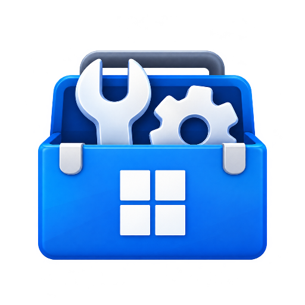

# Windows Toolkit



The animated Stream Deck plugin for Windows **developers, podcasters, gamers and traders**. Version **3.0.0.0** has 97 actions, from display, audio, live system stats, power, timers and developer tools to Game Bar and a market clock, plus app, folder and website launchers. It ships ready-made profiles for each kind of user and a double-click installer.

Everything uses Windows' own features. There are no accounts, cloud services or third-party apps.


## Profiles

Pick one from Stream Deck's profile list, or press its key on page 2 of **Windows Toolkit**. Every profile has a second page (**More ›**) and a **Back** key to your main keys.

| Profile | Page 1 | Page 2 |
|---|---|---|
| **Windows Toolkit** (Core) | Apps, Websites, Screenshot, Show Desktop, Display · Mute, Volume, On Air, Play/Pause · Lock, Clipboard, Copy, Paste | Profile keys · Monitor Control, Night Light, HDR, Brightness · Project, Next Screen, Snap, Desktops, Task View |
| **Developer** | Terminal, Run Command, Port Check, Shortcut · CPU, Memory, GPU, Download, Top App · Snippet, GUID, Timestamp, Clip Tools | Workspace, Pomodoro, Timer, Stopwatch · window keys · Clipboard, Text Case, Clocks, Lock |
| **Podcast** | On Air, Push to Talk, Mic Level, Mute · Input, Output, App Volume, Mixer, Soundboard · media keys, Stopwatch | Record, Timer, Do Not Disturb, Sleep Screens · Volume, Brightness, Night Light · Clocks, CPU, Upload |
| **Gaming** | Game Bar, Game Mode, Clip 30s, Record · Game Shot, Performance, HDR, Power Plan, On Air · CPU, GPU, Memory, Ping | Output, Input, Mute, App Volume · network, Top App, Close/Force Close · Volume, media, Sleep Screens |
| **Trading** | Market Clock, Market Bell, Journal, Screenshot · To Screen 1/2/3, Snap, On Top · NYC clock, Clock, Timer, Lock | Do Not Disturb, window keys · CPU, Memory, Download, Ping, Uptime · On Air, Mute, Play/Pause, Clipboard, Sleep Screens |


## New in 3.0

| Group | Keys |
|---|---|
| **Display & Windows** | Display Settings, Night Light (opens its toggle), HDR, Brightness +/− (laptop and DDC/CI monitors), Project, Next Screen, Snap, Always on Top, Virtual Desktop, Task View, Clipboard History, Emoji, Lock PC, Sleep Screens |
| **Audio** | Mute (shows state), Mic Mute (red On Air while live), Push to Talk, live Mic Level, Switch Output, Switch Input, App Volume (one app), Volume Mixer, Soundboard, Previous / Play-Pause / Next |
| **System Monitor** (live, every second) | CPU, Memory, GPU, Disk Activity, Disk Free, Download, Upload, Ping, Wi-Fi Signal, Battery, Uptime, Top App, Processes, Task Manager, Resource Monitor. Rings turn amber above 60% and red above 85% |
| **Power & Control** | Sleep, Restart, Shut Down, Sign Out, Hibernate, Force Close, Restart Service and Empty Recycle Bin need a **1-second hold**: a red ring fills, and a tap only warns. Also Power Plan (shows the plan), Close App, Wi-Fi / Bluetooth / Airplane on-off (shows state), Do Not Disturb (opens its toggle) |
| **Productivity & Developer** | Timer, Stopwatch, Pomodoro (tap start/pause, hold reset), Clock, World Clock, Run Command (✓/✕ by exit code), Terminal Here, Text Snippet, Keyboard Shortcut (Win combos too), Workspace (open several items), Port Check (localhost server up/down), New GUID, Timestamp, Clipboard Tools (JSON, Base64, URL, trim), Text Case |
| **Gaming & Trading** | Game Bar, Game Mode (shows state), Clip Last 30s, Record (timer while recording), Game Screenshot, Performance overlay, Market Clock (Pre-market / Open / After-hours countdown; editable hours and time zone), Market Bell, Journal Note, Move to Screen 1–4 |

Select a key in Stream Deck to change its settings. Every key keeps the Toolkit design: Colourful, Vivid and Pro looks, 29 colour themes, your own label, icon or picture, and its own animation on a 12-second loop.

Not possible with Windows' own features, so left out: live FPS, stock prices, and OBS/Spotify/Discord control. Windows has no supported switch for Night Light or Do Not Disturb, so those keys open the Windows toggle instead.

## Install

1. Download **WindowsToolkit-Installer-3.0.0.0.zip** from [the latest release](https://github.com/nikhilgs817/windows_toolkit/releases/latest).
2. Right-click the ZIP → **Extract All**, then open its **WindowsToolkit-Installer** folder.
3. Double-click **Install-WindowsToolkit.cmd** and wait for the success message. Stream Deck restarts automatically.

No Git, Node.js or build steps are needed. The installer checks prerequisites, backs up the current setup, preserves existing keys/settings, and adds missing compatible starter/Apps/Websites layouts. On a detected compatible 15-key deck, choose **Windows Toolkit** from Stream Deck's profile dropdown to begin. You can also drag actions from its category onto any supported deck and select a key to configure it.

Requires Windows 10/11 64-bit and Stream Deck 7.1+. If Stream Deck needs installing/updating, the script uses the official Elgato package through Windows Package Manager; Windows may request administrator approval. [Full installation, updates, troubleshooting and recovery instructions](docs/INSTALL.md).

Already downloaded this repository? Double-click its **Install-WindowsToolkit.cmd** to retrieve and install the prebuilt release. For manual installation, open **com.windowstoolkit.core.streamDeckPlugin** from the release and accept Stream Deck's prompts.

Previously named Daily Ops and Windows Daily Toolkit. Version 3.0 also renames the internal plugin ID to `com.windowstoolkit.core`, so keys made with an older version must be added again; the installer backs up and removes the old plugin.

The bundled editable **Apps** and **Websites** profiles each start with Back and an unconfigured launcher, with space for your shortcuts. A **Windows Toolkit** starter profile provides everyday controls. These layouts target a 15-key deck. The script imports missing layouts for compatible detected devices; manual installation offers them through Stream Deck. Existing layouts are kept.

## Original actions

- **Open App**: select an installed app or enter an advanced launch target and arguments. The selected app supplies the default icon and label.
- **Folders**: open any folder using its full path. In File Explorer, click the address bar or press Alt+D, copy the path and paste it into the key's settings. Environment variables such as `%USERPROFILE%\Documents` work too. Enable **Use the folder name** for an automatic label; a custom Label in Look overrides it. Includes real folder icons, all looks, animation and monitor gestures. The former Open Folder entry is hidden, with its action ID still supported for old layouts.
- **Open Website**: enter a URL and choose a browser. Under Look, choose Site icon, Colourful or Vivid, a colour theme, custom label or artwork, and Gentle loop animation. Use the Windows Toolkit action to get these controls; Stream Deck's built-in Website action has different settings.
- **Website Folder**: open the plugin's editable Websites collection, with the animated ocean folder/globe icon. Use **Open Websites** in its settings to configure the page in Stream Deck. Add Open Website keys and their URLs; keep Back to return to your main keys. The collection pauses companion focus switching while open.
- **Apps** and **Back to Main Keys**: open your editable Apps profile and return to the previous keys.
- **Screenshot**: tap to select an area, double-tap for the active window, or hold for all screens. Configure the hold time, file saving and clipboard behavior in settings. Area capture uses Windows Snipping Tool.
- **Show Desktop**: show the desktop; press again to restore your windows.
- **Volume Up** and **Volume Down**: adjust volume, with optional hold to repeat.
- **Monitor Control**: choose one physical monitor per key. A connected screen shows red **TURN OFF**; a disconnected screen shows green **TURN ON**. The main display can be disconnected while another screen remains active. The last active screen stays on.
- **Copy** and **Paste**: send Ctrl+C and Ctrl+V to the active window.

Launcher gestures select monitor 1 with a tap, monitor 2 with a double-tap and monitor 3 with a hold. Adjust monitor ordering and timing, or disable gestures, in **Which monitor**. Some apps manage their own window placement.


## App companion profiles

Optional companion plugins provide app-specific controls for [VS Code](https://github.com/nikhilgs817/streamdeck_vscode), [ChatGPT](https://github.com/nikhilgs817/streamdeck_chatgpt), [Claude](https://github.com/nikhilgs817/streamdeck_claude), [thinkorswim](https://github.com/nikhilgs817/streamdeck_thinkorswim) and [Fidelity Trader+](https://github.com/nikhilgs817/streamdeck_fidelity_trader_plus) and [TradingView](https://github.com/nikhilgs817/streamdeck_tradingview). Install the desired companion and accept its editable profile. Select that app with Open App and leave Switch keys enabled.

The deck follows the foreground app, whether you opened it from Apps or switched to it elsewhere. Direct app changes restore the main profile before showing the next companion. Back returns to the main keys and prevents an immediate switch back until you leave and return to the app. The Back key in each companion offers Follow focus. Companion profiles share animated looks and colour themes; they are separate plugins and repositories.

App recognition uses process names and, for packaged apps and thinkorswim's Java runtime, executable paths. A local named pipe coordinates profile changes. No app content, credentials or account data crosses that channel. Only installed, connected companions can be selected.

## Optional app credentials

Open App can store a username and an encrypted password for the selected app. Enter them under **App credentials**, choose whether to enable **Autofill**, and select **Save credentials**. Use the eye to show or hide a password, or **Clear** to remove the saved credentials. Revealed saved passwords hide and clear from the input after 20 seconds or when the settings window loses focus. Changing the selected app clears its credentials.

Passwords are encrypted with Windows DPAPI for the current Windows user and bound to the selected app. Settings contain encrypted password data; the username is stored as ordinary text. Passwords are not placed in process arguments, logs or the clipboard. Saved credentials are local to the Windows account and are not a portable password vault.

Autofill opens the selected app, verifies its foreground executable path or application identity, and looks for one recognizable username field and one editable password field. Keep the app's login form in front. **Review and submit the login yourself**; autofill never presses Enter or Sign In.

Compatibility depends on the app exposing native login controls through Windows accessibility. Embedded web forms, separate login processes, elevated apps and custom controls may not support filling. Ambiguous fields, an unverified app or a focus change stop filling. Commands and links can launch apps, but autofill requires a verifiable installed app entry or full executable path. Multifactor authentication remains in the app.


## Appearance

Choose **Colourful**, **Vivid**, **Pro**, or the real app/site/folder icon where available. Customize the theme, glyph and label, hide the label, or upload your own picture. There are 29 colour themes, including Sunset, Tropical, Electric, Cosmic, Peach and Lemonade.

Every plugin action supports a matching six-second animation at 12 frames per second, including Colourful, Vivid, Pro and real-icon looks. Folders open gently, app tiles move, volume waves pulse and documents shift on Copy/Paste. Real app/site icons float subtly; custom pictures keep their composition with a moving edge. Labels stay still. Monitor Control keeps its red/green state colours and uses animated edging.

Turn **Look → Animation → Gentle loop** off on any key for a still image. A shared clock draws only visible keys, skips busy renders and stops when no animated keys are visible. The optional editor companion supports the same looks and motion.

Existing native Stream Deck shortcuts can use exported animated GIF artwork. These pictures are part of a personal profile, separate from the plugin installer; they do not change the shortcut's app, website or navigation target. Replace their picture with a still image to stop that GIF.

## Troubleshooting

- A warning triangle usually means a destination is missing or a required setting is empty. Select the key and check its settings.
- If autofill cannot recognize a form, enter the credentials in the app. The password can still be stored and viewed from the key settings.
- If Monitor Control shows SELECT, choose a monitor. NOT FOUND means the selected physical screen is unavailable; the key never falls back to a different screen.
- Some monitors disappear from Windows during deep sleep. Disable that monitor option, disable **Sleep the monitor** on the key, or use the monitor's power button to wake it.
- Managed PCs may block the hidden PowerShell worker used for Windows integration.
- Logs are under `%APPDATA%\Elgato\StreamDeck\Plugins\com.windowstoolkit.core.sdPlugin\logs`.

Monitor labels use Windows display-topology metadata. This resolves source-number reversals on the development PC, but Windows does not expose a documented public API for the Settings page's display ordinals. Check the screen names when configuring a different GPU, dock or topology.

## Data and connections

Credentials and Windows controls run locally. Website icon retrieval sends the website hostname to a public favicon service and may fetch an icon directly from that website; results are cached. Opening a website or app uses the destination you configure. The plugin does not send credentials to an external service.

The installer downloads the matching public release from GitHub when its package is not included locally, and may use Windows Package Manager for the official Elgato software prerequisite. Installer backups and logs stay on your PC and are not uploaded.

## Development

This repository contains Windows Toolkit and the shared artwork, settings and Windows helpers it needs. The optional VS Code companion is maintained separately and is not required to build or use this plugin. Use Node.js 20 or later and npm.

```sh
git clone https://github.com/nikhilgs817/windows_toolkit.git
cd windows_toolkit
npm ci
npm run build
npx tsc --noEmit
npm test
npm run test:ui
npm run test:animation
npm run test:companions
npm run test:native
npm run test:credentials
npm run validate
npm run pack
npm run build:installer
npm run test:installer
```

The build writes `plugins/windowstoolkit/com.windowstoolkit.core.sdPlugin/`; packaging writes `dist/com.windowstoolkit.core.streamDeckPlugin`. `build:installer` bundles that package, its checksum manifest, the PowerShell installer, CMD launcher and instructions into `dist/WindowsToolkit-Installer-3.0.0.0.zip`. Run `pack` before building the installer. The installer test suite exercises isolated first-install, update, repeat-install, path-validation and rollback cases; it does not operate your real Stream Deck. Generated plugin folders, installers and dependencies are excluded from Git. Publish the installer ZIP, plugin package and `dist/installer-manifest.json` together as release assets.

The browser inspector checks use installed Edge on Windows; elsewhere install Playwright Chromium first. Native helper checks require Windows and use synthetic credentials without opening application login screens.

Development uses Rollup's official WebAssembly build, avoiding its platform-specific native parser dependency. This does not add a runtime dependency for plugin users.

`plugins/windowstoolkit/` contains the plugin source, `shared/` contains artwork, settings and Windows helpers, and `tools/` contains build and verification tools. Compatibility hooks for the optional companion remain in the shared code; its separate plugin implementation is not included here.

Keep distributed defaults, examples and product copy app-agnostic. Never package personal profiles, credentials, runtime logs or icon caches. Local validation and packaging do not constitute Marketplace approval.
